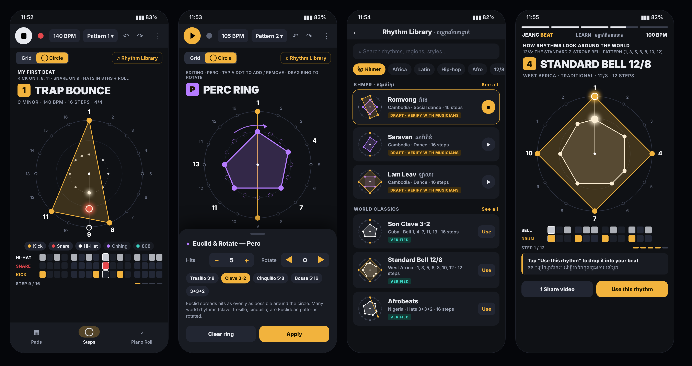
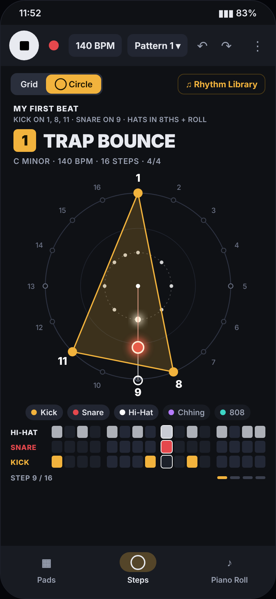
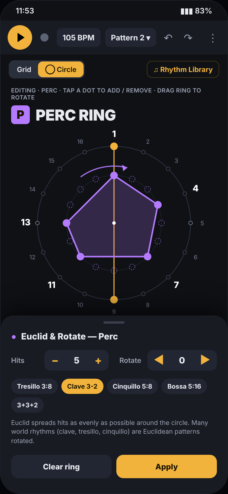
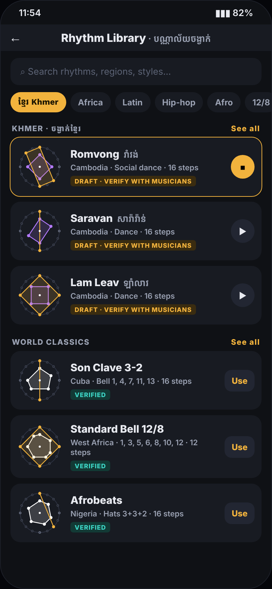
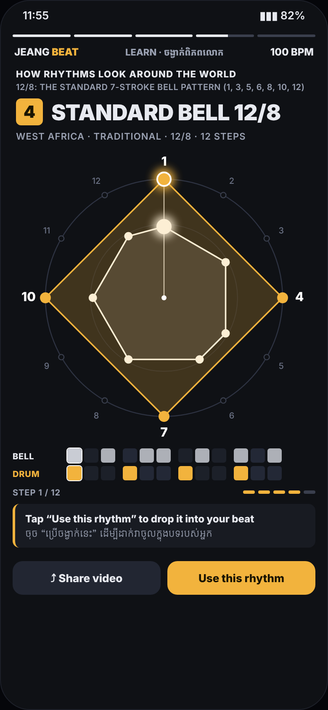

# Rhythm Circle: draft design

Status: **draft for review**, not implemented yet.
Inspired by a reference video (a "Drum View" that shows Nigerian rhythms as shapes on a circle).

---

## 1. What the reference video does

| Element | What it shows | Why it works |
|---|---|---|
| **Circle of steps** | 16 (or 12) numbered points around a ring, step 1 at the top, like a clock | One bar is one full turn, and repetition becomes visible |
| **Shape per instrument** | Each instrument's hits are joined into a polygon (bass = red outer shape, bell = white inner shape) | Patterns become shapes you can recognise: a triangle, a pentagon, a diamond. Symmetry and swing show at a glance |
| **Rotating hand** | A thin line from the centre sweeps to the current step, with a small marker ring | You can see where you are in the bar, and hits light up as the hand passes |
| **Big step numbers** | Steps where the main drum hits are drawn larger (1, 7, 9, 11…) | You can read the key accents without counting |
| **Mini step grid** | 2–3 rows (hi-hat / rim / kick) under the circle, with the current column highlighted | It links the circle to the familiar grid |
| **Header** | Pattern number badge, name, "country · era · 16 steps", and a one-line description listing hit positions | Each pattern is presented as a lesson |
| **Odd meters** | Ìlù Yorùbá uses 12 steps (12/8), and the circle redraws with 12 points | It shows compound and triplet feels, which a 16-step grid cannot |
| **Progress** | "Step 9/16", plus page dots for which rhythm out of 4 | Story-style sequence |

## 2. The idea for Jeang Beat

Add a **Circle** view next to the existing **Grid** in the Steps tab. It is the same pattern drawn differently, and you can edit in either view. Around it sit two new features:

1. **Rhythm Circle view**: see, play and edit a pattern as shapes on a circle.
2. **Rhythm Library**: ready-made rhythms (Khmer, Africa, Latin, Hip-hop…) that you can preview on the circle and drop into a beat.
3. **Learn mode**: a full-screen, story-style slideshow of rhythms, the closest to the video, later exportable as a video to share.

Gold replaces the reference's red so it matches the Jeang Beat theme, and each instrument keeps its own channel colour.

---

## 3. Screens

### Screen 1: Circle view (playing)

- **Grid | Circle switch** at the top of the Steps tab. The choice is remembered per project.
- **Header**: pattern badge (1, 2, 3… = pattern number), pattern name, key · BPM · steps · meter.
  - The description line is **generated automatically** from the notes, e.g. "Kick on 1, 8, 11 · Snare on 9". Users never type it, so it is always correct.
- **The circle**:
  - Step numbers around the edge. Numbers where the outer (main) instrument hits are drawn big and white.
  - **Outer ring = the main drum** (kick by default), as a gold filled polygon.
  - **Middle ring = backbeat / bell / perc** (snare, clap, chhing…). A single hit is drawn as a dot with a spoke from the centre.
  - **Inner ring = dense parts** (hi-hats, shaker). With 8+ hits a polygon becomes a blob, so these are drawn as **dots on a dotted ring** instead.
  - The **rotating hand** sweeps around at tempo, and each dot **glows and grows** as it is hit.
- **Legend chips** under the circle. Tap a chip to show or hide that instrument on the circle (max 3 rings visible, to keep it readable). Long-press a chip to choose which ring it uses.
- **Mini grid**: the visible instruments as compact rows, with the current step outlined. Tapping a cell toggles it, same as the big grid.
- **"Step 9 / 16"** counter and **pattern dots** (which pattern of the project is shown). Swipe left or right on the circle to change pattern.

### Screen 2: Editing a ring (tap, rotate, Euclid)

- **Tap a ring** (or its legend chip) to select it. That ring turns bold, and empty step slots appear as dashed circles.
- **Tap a slot** to add a hit, **tap a dot** to remove it, and **long-press a dot** for velocity. Previews sound immediately, same as now.
- **Drag around the ring** to **rotate** the whole pattern for that instrument by whole steps. This is the main reason a circle is useful for editing: shifting a clave or hat pattern is one gesture instead of re-entering every step.
- **Euclid & Rotate sheet** (opens from the selected ring):
  - **Hits**: −/+ for how many hits, spread as evenly as possible (Euclidean rhythm).
  - **Rotate**: ◀ / ▶ to shift by one step.
  - **Presets**: Tresillo 3:8, Clave 3-2, Cinquillo 5:8, Bossa 5:16, 3+3+2. These are well-known, verifiable patterns.
  - **Apply** is one undo step, and **Clear ring** empties that instrument.

### Screen 3: Rhythm Library

- Opens from **♫ Rhythm Library** on the Circle view.
- **Search**, plus **region chips**: ខ្មែរ Khmer · Africa · Latin · Hip-hop · Afro · 12/8.
- **Cards** have a mini circle preview, name (with the Khmer name), origin · style · steps, and a ▶ preview that plays on a loop, using your current kit.
- **Use** adds the rhythm as a **new pattern** in your project. Library instruments are mapped to your channels (bell → Perc/Chhing, low drum → Kick…), and any missing channels are created.
- **Verification tags**:
  - **VERIFIED** means a well-documented pattern (son clave, 12/8 bell, Afrobeats 3+3+2).
  - **DRAFT · VERIFY WITH MUSICIANS** is used for Khmer rhythms until they are transcribed with Khmer musicians. **The Khmer shapes in the mockup are placeholders, not real transcriptions.**

### Screen 4: Learn mode (story slideshow)

- Full screen, like the reference video: **story progress bars** at the top, and auto-advance after N loops.
- **Header** with a series title ("How rhythms look around the world"), badge number, name, region · tradition · meter · steps, and a description with hit numbers.
- Big circle with the hand, a mini grid, and step and page counters.
- **Bilingual caption box** (English and Khmer).
- **Use this rhythm** adds it to your beat. **Share video** exports a short vertical MP4 of the animation with audio, for TikTok / Facebook. Export comes in M5.
- Shown here: the 12-step **12/8 standard bell** (1, 3, 5, 6, 8, 10, 12), which proves the app supports compound meter.

---

## 4. Visual rules

| Item | Rule |
|---|---|
| Ring radii | Outer 100%, middle 62–66%, inner (dense) 36% of the step circle |
| Shapes | Fill = channel colour at 16–22% opacity, stroke 1.8 dp (2.6 dp when selected) |
| Hit dots | 5 dp, or 6.5 dp on the main ring. When hit: 8 dp with a white outline plus a soft glow |
| Step markers | Small hollow circles. Beat positions (every 4th, or every 3rd in 12/8) are brighter |
| Numbers | 10 sp grey. Main-drum hits are 15 sp bold white |
| Hand | 1.2 dp white line at 75% opacity, with a 6 dp ring marker at the edge |
| Colours | Jeang Beat theme: gold accent, channel palette. Never colour-only: every ring also has a label in the legend and grid |
| Accessibility | Each step is a semantic element ("Kick, step 8, on, velocity 110") for TalkBack. Tap targets are ≥ 40 dp, so on small phones the slot circles grow |

## 5. Behaviour details

- **Sync**: Grid, Circle and Piano Roll edit the **same notes**. Nothing is copied or converted.
- **Off-grid notes** (from the piano roll or recording) are drawn at their exact angle, so the circle shows swing and push/pull timing that the grid hides.
- **Swing** visibly shifts the off-beat dots clockwise when the swing slider moves. It's a good teaching moment.
- **Melodic channels** (808, synth) can be shown as rings too, using note start times only. Pitch stays in the piano roll.
- **Performance**: drawn on one Compose `Canvas`. The hand position is read once per frame, like the existing playhead, so there is no extra audio-thread work.

## 6. What has to change in the app

| Area | Change |
|---|---|
| **Model** | `Pattern` gains a **meter / step size**: 16th steps (24 ticks) as today, or **triplet 8th steps (32 ticks)** for 12/8, plus 6, 9 and 24-step options. `lengthTicks = steps × stepTicks` |
| **Model** | Optional pattern metadata: `origin`, `era`, `description` (for library items). The user's own description is auto-generated |
| **Model** | New pure functions: `rotateChannel(channelId, steps)` and `euclid(hits, steps, rotation)`, both unit-tested |
| **Engine** | Nothing changes, because it already works in ticks. Swing must apply only to 16th grids, not 12/8 (one small check) |
| **New module** | `feature/rhythmcircle`: the circle canvas, ring editing gestures, and the Euclid sheet |
| **New module** | `core/library`: rhythm definitions as JSON in assets, with region, verified flag, BPM, meter, parts and instrument roles |
| **App** | Grid/Circle toggle, library screen, learn mode, and "Use" → new pattern with channel mapping |
| **Later (M5)** | Video export of learn mode (MediaCodec + offline render of the engine) |

## 7. Khmer rhythms plan

The library is the best place for Jeang Beat's Khmer identity, but **the patterns must be correct**.

1. Collect candidate rhythms, e.g. Romvong (រាំវង់), Saravan (សារ៉ាវ៉ាន់), Lam Leav (ឡាំលាវ), Chhayam (ឆៃយ៉ាំ), Kantrem (កន្ទ្រឹម), plus Pin Peat drum patterns.
2. Transcribe each with a Khmer musician: steps, which drum or instrument, accents, and typical tempo.
3. Record the instruments (skor, chhing, sampho…) to replace the synthesised placeholders.
4. Only then mark them **VERIFIED**. Until then they show the **DRAFT** tag, or are hidden in public releases.

## 8. Suggested build order

| Step | Scope | Size |
|---|---|---|
| A | Circle view, read-only (rings, hand, legend, mini grid) and the Grid/Circle toggle | small |
| B | Editing on the circle: tap / long-press / drag-rotate, and the Euclid sheet | medium |
| C | Meter support (12/8 and others) in model + UI | small–medium |
| D | Rhythm Library with ~10 verified world rhythms, and "Use" | medium |
| E | Learn mode slideshow | small |
| F | Khmer rhythms (after transcription) and video export (with M5) | depends on musicians |

A–E can come **before M4** (song/mixer), or alongside it.

## 9. Open questions

1. Should Circle replace the grid by default for new users, or stay an option? *(Suggestion: grid by default, with Circle one tap away.)*
2. Max visible rings: 3 (cleaner) or 4?
3. Can you connect us with Khmer musicians to transcribe and record rhythms?
4. Learn-mode video export: watermark "Made with Jeang Beat", yes or no?

---
Mockups are generated from [`mockups.html`](mockups.html), which draws real rhythm data with SVG.
To re-render them, open the file in a browser or run Playwright and screenshot `#s1`–`#s4`.
