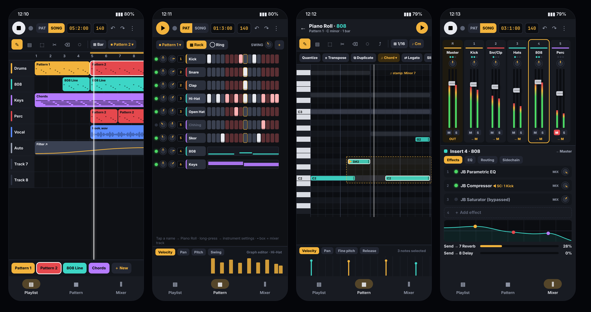
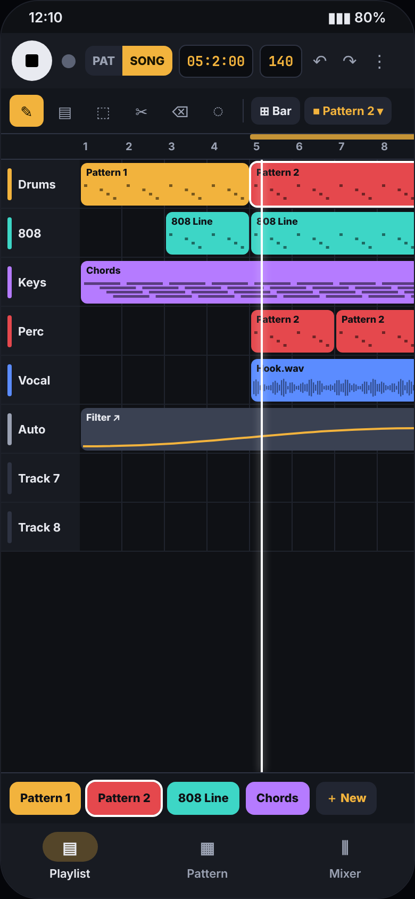
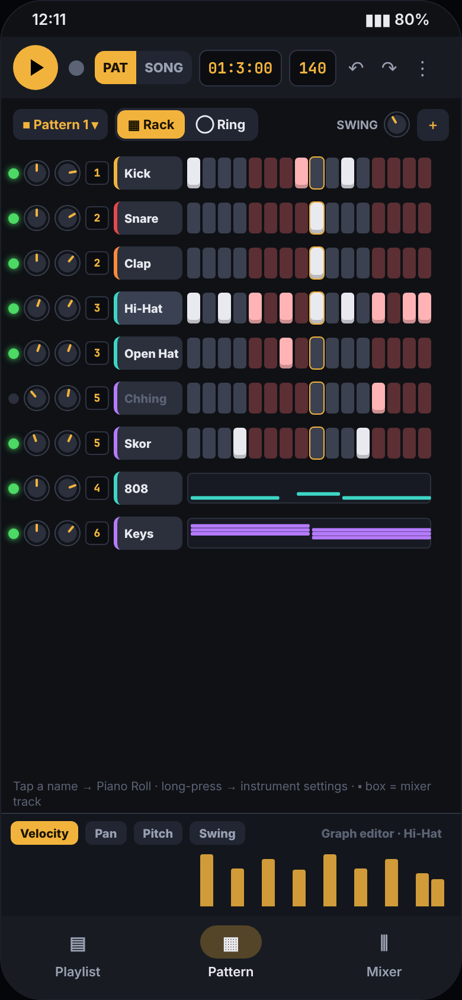
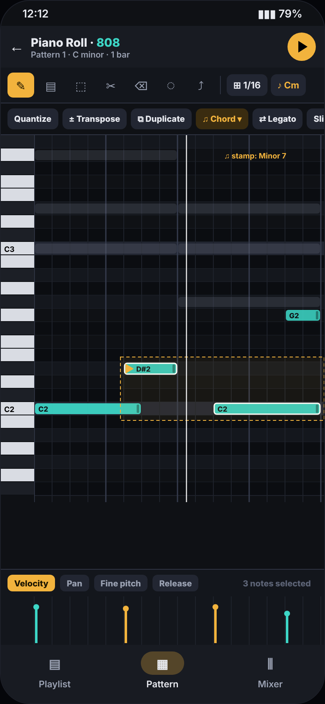
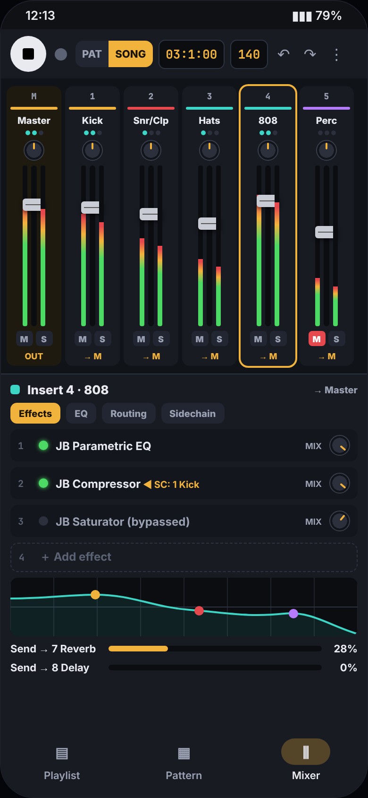

# Jeang Beat 2.0: Playlist · Pattern · Mixer

Status: **draft for review**, not implemented yet.
Direction (from the product owner): work like **FL Studio PC**, keeping Jeang Beat's simple phone-first feel.



## 1. The decisions

| # | Decision | Result |
|---|---|---|
| 1 | Remove **Pads**, add **Playlist** like FL Studio | New tab: arrange patterns, audio and automation into a song. Pick and edit patterns from here |
| 2 | Rename **Steps** to **Pattern**, styled like the FL Studio PC Channel Rack, plus the **Ring** view | Pattern = channel rack + ring. Tapping an instrument opens its Piano Roll |
| 3 | **Piano Roll** becomes a sub-screen of Pattern, and its tab is replaced by **Mixer** | Mixer tab with FL Studio PC features. The Piano Roll gets FL's basic and important tools |

### New navigation

```
Bottom tabs:   [ Playlist ]   [ Pattern ]   [ Mixer ]
                    │              │            │
                    │              ├── Rack / Ring (switch)
                    │              ├── Piano Roll  (tap instrument name, or double-tap a clip in Playlist)
                    │              └── Instrument settings (long-press name)
                    └── Pattern picker → opens that pattern in Pattern tab
Transport (top of every tab):  ▶/■  ●rec  [PAT|SONG]  position  BPM  undo/redo  ⋮
```

**PAT / SONG** is the FL Studio switch. **PAT** loops the current pattern (what the app does today). **SONG** plays the Playlist from the song position.

---

## 2. Playlist (replaces Pads)



How it maps to FL Studio PC:

| FL Studio PC feature | Jeang Beat 2.0 |
|---|---|
| Tracks (rows), any clip on any track | 8 tracks to start, add more with ＋. Name, colour, mute and solo per track |
| Pattern clips | Coloured blocks showing a mini note preview. One pattern can be placed many times |
| Audio clips | Waveform blocks (e.g. a vocal `Hook.wav`). *Needs audio import or recording, see phase plan* |
| Automation clips | A curve clip for any knob (filter, volume…). *Phase 2.3* |
| Tools: Draw, Paint, Select, Slice, Delete, Mute | Toolbar ✎ ▤ ⬚ ✂ ⌫ ◌ (same order as FL) |
| Snap (Bar / Beat / Step…) | "⊞ Bar" chip |
| Pattern picker ("which pattern am I painting?") | Coloured chips at the bottom, and "■ Pattern 2 ▾" in the toolbar. **＋ New** creates an empty pattern |
| Loop region / song marker | Gold bar on the ruler = loop region. White line = song position |
| Make unique / clone | Long-press a clip → *Make unique* (copy the pattern so edits only affect this clip) |
| Resize clip | Drag the right edge: shorter cuts the pattern, longer repeats it |

**Gestures (phone):** tap an empty lane to paint the selected pattern (Draw tool). Drag a clip to move it, and drag its edge to resize. Pinch to zoom, and use two fingers to scroll. Double-tap a clip to open that pattern in **Pattern**. Long-press a clip for the menu: make unique, rename, colour, delete.

## 3. Pattern (renames Steps): Channel Rack + Ring



How it maps to the FL Studio PC Channel Rack:

| FL Studio PC | Jeang Beat 2.0 |
|---|---|
| Mute LED (green) | ● on the left. Tap to mute, long-press to solo |
| Pan and Volume knobs | Two small knobs. Drag up or down, and double-tap to reset |
| Mixer track number box | ▪ "4" = which Mixer insert this channel plays through. Tap to choose |
| Channel name button | Tap → **Piano Roll**. Long-press → instrument settings (sound, 808, synth…) |
| Step buttons in groups of 4 (alternating colours) | 16/32/64 steps, alternate groups tinted red like FL |
| Melodic channel shows a **mini piano roll** instead of steps | Yes: 808 and Keys show their notes in the row |
| Graph editor (Velocity, Pan, Pitch, Swing… per step) | Bottom panel with tabs. Drag bars to edit the selected channel |
| Pattern selector | "■ Pattern 1 ▾" (same list as the Playlist picker) |
| Global swing | Swing knob |
| ＋ Add channel | ＋ button → drum sound / 808 / synth (later: sampler, audio) |

**Ring view:** the **Rack | Ring** switch turns the same pattern into the circle view from [`../rhythm-circle`](../rhythm-circle/README.md): instrument shapes, rotating playhead, drag-to-rotate and Euclid. Both views edit the same notes.

## 4. Piano Roll (sub-screen of Pattern)



FL Studio PC's basic and important piano roll features, adapted for touch:

| Group | Features |
|---|---|
| **Tools** | ✎ Draw (tap to add, uses last note length) · ▤ Paint (drag to paint repeated notes) · ⬚ Select (marquee) · ✂ Slice (cut a note in two) · ⌫ Delete · ◌ Mute (keeps the note, silent) · ⤴ Slide (FL "slide note": glides into the next pitch, perfect for 808) |
| **Snap** | Bar, Beat, 1/8, 1/16, 1/16T, 1/32, None |
| **Scale** | Key + scale highlighting (out-of-scale rows dark), optional fold, and scale lock |
| **Ghost notes** | Notes of other instruments in the same pattern shown faintly |
| **Edit actions** | Quantize (start and/or length, with strength %) · Transpose (±1 semitone, ±1 octave) · Duplicate selection (FL Ctrl+B) · Copy / Paste · Select all · Legato (stretch notes to the next one) · Flip · Randomize velocity (small %) |
| **Chord stamp** | FL "Stamp": pick a chord (Major, Minor, 7th, Minor 7, Sus…) and every tap draws the whole chord |
| **Note property lanes** | Velocity · Pan · Fine pitch · Release (drag bars, edits the selection when one exists) |
| **Navigation** | Pinch zoom (time and pitch), two-finger scroll, a ▶ button to play just this pattern |
| **Later** | Arpeggiator tool, strum, chop, and a "Riff machine"-style generator |

## 5. Mixer (replaces the Piano Roll tab)



How it maps to the FL Studio PC mixer:

| FL Studio PC | Jeang Beat 2.0 |
|---|---|
| Master + numbered insert tracks | Master (M) + inserts 1…32. Scroll strips horizontally (landscape and tablet show more) |
| Fader, pan, peak meters (stereo) | Yes, with dB readout on touch |
| Mute / Solo, name, colour | Yes |
| **10 effect slots** per track, each with on/off and **mix** knob | Effects tab: slots 1–10, power LED, mix knob, drag to reorder |
| Built-in effects | **JB Parametric EQ**, **Compressor** (with sidechain input), **Limiter**, **Reverb**, **Delay** (tempo-synced), **Saturator/Distortion**, **Filter** (LP/HP/BP with resonance), **Chorus** (later) |
| Per-track EQ display | EQ tab: 3-band curve with draggable points (shown under the slots in the mockup) |
| **Routing / sends** (send any track to any track with a level) | Routing tab: "Send → 7 Reverb 28%". Every track goes to Master by default |
| **Sidechain** | Sidechain tab: choose the source (e.g. *1 Kick*). The compressor ducks the 808 when the kick hits, the classic trap/EDM pump |
| Channel → mixer assignment | The ▪ number box in the Pattern rack |
| Phase invert, swap L/R, stereo separation | In the track ⋮ menu (later) |
| Record arm (audio input) | Later, with audio recording |

---

## 6. What happens to the current features

| Today (v0.1) | In 2.0 |
|---|---|
| Pads tab | **Removed** as a tab, as decided. *Optional idea:* keep the pad code as a "Perform" overlay in Pattern for finger-drumming and recording. It's cheap to keep and helps beginners. Your call |
| Steps tab | Becomes **Pattern** (FL rack layout) |
| Piano Roll tab | Moves inside Pattern, with the FL tools above |
| Note repeat, live record | Move to the Pattern / Piano Roll record button |
| Rhythm Circle design | Becomes the **Ring** view in Pattern |

## 7. Engine work needed (C++)

| Feature | Engine change |
|---|---|
| SONG mode | Play the Playlist: the timeline of clips → per-pattern note events with offsets, plus the loop region |
| Mixer | Per-insert audio buses (channels → insert → master), fader/pan/mute/solo, peak meters for the UI |
| Effects | DSP for EQ, compressor, limiter, reverb, delay, saturator and filter, all real-time safe (no allocation on the audio thread) |
| Sends & sidechain | Bus graph with send levels. Process in dependency order and reject loops |
| Audio clips | Load and decode WAV/MP3, stream from memory, time-align to the song |
| Automation | Parameter curves sampled per block |

The existing design (lock-free snapshots, nothing locked or allocated in the audio callback) extends to all of this.

## 8. Build plan for 2.0

| Phase | Scope | You can test |
|---|---|---|
| **2.1 Navigation + Pattern rack** | New tabs, transport with PAT/SONG, FL-style channel rack (LED, knobs, mixer box, mini roll, graph editor), Rack/Ring switch (Ring read-only) | New layout on your phone |
| **2.2 Piano Roll (FL basics)** | Tools, selection, quantize, transpose, duplicate, copy/paste, chord stamp, slide notes, property lanes | Writing melodies and 808s |
| **2.3 Playlist + SONG mode** | Tracks, pattern clips, tools, snap, loop region, make unique, song playback | Building a full song |
| **2.4 Mixer core** | Inserts, faders, pan, meters, routing, EQ, compressor, limiter, reverb, delay, saturator, filter | Mixing a beat |
| **2.5 Sends, sidechain, Ring editing** | Send buses, sidechain compressor, Ring tap/rotate/Euclid | Trap "pump", world rhythms |
| **2.6 Audio & automation** | Import audio, audio clips, automation clips | Vocals, filter sweeps |
| **Then M5** | Export WAV/MP3/stems, video share, first public APK | |

Each phase ends with a new APK from GitHub Actions for you to test.

## 9. Questions for you

1. **Pads:** remove completely, or keep as a hidden "Perform" overlay inside Pattern? *(Suggestion: keep the overlay.)*
2. **Orientation:** FL Studio Mobile works best in **landscape** for Playlist and Mixer. Should 2.0 support both, or lock some screens to landscape? *(Suggestion: support both, with landscape showing more tracks and strips.)*
3. **Playlist audio:** is importing vocals or samples needed in 2.0, or can it wait until after export?
4. **Phase order:** start with **2.1 + 2.2** (Pattern + Piano Roll), or with **Playlist** first?

---
Mockups are generated from [`mockups.html`](mockups.html), which draws real pattern data with HTML/SVG.
